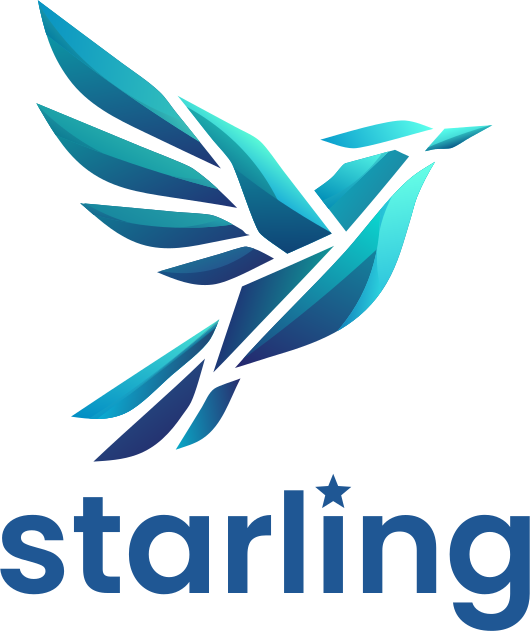

<p align="center">
  
</p>

# Starling

My shared instructions, skills, scripts and checks for coding agents. Each
repository installs Starling as a committed `.starling/` folder, so the
rules are written once and every clone, CI run and agent session has them,
with nothing to set up on the machine.

Starling is built for my own repositories and assumes how I work: GitHub,
rebase merges, Conventional Commits and a lot of the work done by agents.
It is public and MIT-licensed, so read it or borrow from it, but I do not
support other setups.

The reasons behind all of this are in [docs/design.md](docs/design.md).

## What a repository gets

- **Shared rules for agents:** `.starling/AGENTS.md`, pulled into the
  repository's `AGENTS.md` by one import line.
- **Checked commit messages:** one script,
  `.starling/bin/check-commit-msg`, run by a commit-msg hook and by a CI
  workflow on ready pull requests and pushes to the default branch.
- **A guard against skipped checks:** a Claude Code hook that stops agents
  from bypassing the git hooks.
- **[Skills](#skills)** for the work around issues, commits and pull
  requests, for Claude Code and Codex.

Everything lives in the repository. Nothing is installed per user or per
machine: no global git hooks path, nothing on `PATH`, nothing in
`~/.claude` or `~/.codex`.

## Requirements

- git, POSIX `sh` and POSIX `awk`, for every script and hook.
- `gh`, signed in, for the skills that work with GitHub. Joining pull
  requests into a stack also needs the `gh stack` extension.
- `jq`, only to merge Starling's settings into an existing
  `.claude/settings.json`. Without it, the installer says what to merge.

## Install

In the repository:

```sh
curl -fsSL https://raw.githubusercontent.com/birdhimself/starling/main/install | sh
```

That installs the newest release. For a given one, end the command with
`| sh -s -- vX.Y.Z`.

Nothing is committed. Review the changes and commit them; the installer
prints the header to use, `build: install Starling vX.Y.Z`.

Besides `.starling/`, the installer sets up:

| Path                                             | What                                                                            |
| ------------------------------------------------ | ------------------------------------------------------------------------------- |
| `AGENTS.md`                                      | One import line after the first heading. A lone `CLAUDE.md` is renamed to this. |
| `.claude/skills/<name>`, `.agents/skills/<name>` | A link to each of Starling's skills, for Claude Code and Codex.                 |
| `.github/workflows/starling-commits.yml`         | The CI check of every commit.                                                   |
| `.claude/settings.json`                          | The Claude Code hooks, and Claude Code's own commit and pull request lines off. |
| `.prettierignore`                                | `.starling/`, in a project that uses Prettier.                                  |
| `core.hooksPath` in the clone's git config       | Points to `.starling/hooks`, unless another tool already set it.                |

If the project uses Renovate, the installer prints a rule to add to its
configuration, so that Renovate leaves Starling's files alone.

### In a repository that already has its own setup

The installer cannot judge what a repository already had: skills that one
of Starling's now replaces, rules in `AGENTS.md` that the shared rules
repeat or contradict, hooks that another tool ran. The `adopt-starling`
skill compares the two, proposes what to remove, what to keep and what to
move into [policy files](#adapting-a-project), and changes only what you
confirm. To install and adopt in one go, paste this into your agent:

```text
Install Starling in this repository:

curl -fsSL https://raw.githubusercontent.com/birdhimself/starling/main/install | sh

Then follow .starling/skills/adopt-starling/SKILL.md to fit the repository
to it. Show me the proposal before you change anything, and commit nothing.
```

The prompt names the file so that it works even when the agent has not
picked up the newly linked skills yet. Later, `/adopt-starling` does the
same, for instance after an update that brought a skill one of your own
overlaps.

## After cloning

`core.hooksPath` is local to a clone, so each clone activates the hooks
once:

```sh
.starling/bin/activate-hooks
```

Claude Code does this at the start of every session. For everyone else, a
dev container's `postCreateCommand` can run it, or a Node `prepare` script:

```sh
test ! -d .starling || sh .starling/bin/activate-hooks || true
```

When another tool such as husky has set `core.hooksPath`, activation leaves
it alone and prints the command that takes over once that tool is gone. CI
still checks every commit in the meantime.

## Update

```sh
.starling/bin/update          # the newest release
.starling/bin/update vX.Y.Z   # a given release
```

This replaces `.starling/` and refreshes the files in the table above. It
refuses to run with uncommitted changes to tracked files, so the diff shows
only Starling's changes, and it commits nothing. Commit the result as
`build: update Starling to vX.Y.Z`.

Never edit files in `.starling/`: the next update overwrites them. Change
them in this repository and release a new version.

## Adapting a project

What a project decides for itself stays outside `.starling/`, where updates
do not touch it.

| To                             | Use                                                                                     |
| ------------------------------ | --------------------------------------------------------------------------------------- |
| Allow commit scopes            | `.starling.conf`, below.                                                                |
| Refine the shared rules        | The project's own `AGENTS.md`.                                                          |
| Add a git hook                 | `.githooks/<name>`, which Starling's hooks run after their own checks.                  |
| Adapt one of Starling's skills | `.agents/policy/<skill>.md`, which that skill reads.                                    |
| Add a skill of its own         | `.agents/skills/<name>/`, linked from `.claude/skills/<name>`. `write-skill` does this. |

The names of Starling's skills are reserved. When a project already has an
entry with one of those names, the installer leaves it alone and says so,
and `adopt-starling` proposes whether to replace or rename it.

`.starling.conf` is in git's config format:

```ini
[commit]
	scopes = client server deps
```

Without `scopes`, commit headers take no scope. `requireScope = true` makes
every header name one, which only suits a project whose scopes cover every
file.

## Skills

In Claude Code, a skill's name is its slash command: `/implement-issue 456`.
No skill merges a pull request.

| Skill                    | What it does                                                                 | Ends at                         |
| ------------------------ | ---------------------------------------------------------------------------- | ------------------------------- |
| `implement-issue`        | Implements an issue with tests, splitting larger work into a stack.          | Draft pull requests             |
| `refine-draft-issues`    | Turns a rough issue into scope, acceptance criteria and validation.          | Updated issue                   |
| `triage-issue`           | Sets an issue's type, labels, fields and relationships.                      | Metadata set                    |
| `commit-changes`         | Commits one topic at a time, with messages that pass the check.              | Local commits, never pushed     |
| `open-pr`                | Checks a finished branch, fills in the template and opens a pull request.    | Draft pull request              |
| `apply-review-findings`  | Checks review findings against the code and applies the ones that hold.      | Folded, pushed commits          |
| `resolve-review-threads` | Answers every unresolved review thread, changing code where a remark holds.  | Threads replied to and resolved |
| `finish-pr`              | Folds fixups, rebases, waits for CI and marks the pull request ready.        | Ready pull request              |
| `ship-issue`             | Implements an issue, has a fresh agent review it and applies the findings.   | Ready pull requests             |
| `ship-issue-batch`       | Does the same for several issues in parallel, optionally as one stack.       | Ready pull requests             |
| `clean-merged-branches`  | Deletes local branches whose work is on the base branch, after confirmation. | Deleted branches                |
| `adopt-starling`         | Fits a repository's own skills, rules and hooks to the installed Starling.   | Changed files, never committed  |
| `write-skill`            | Creates or changes a skill by Starling's rules.                              | Skill files                     |
| `test-skill`             | Lints and validates skills, and runs their evals if you agree.               | Report                          |

## Agents

I use Starling with Claude Code and Codex.

- **Claude Code** gets all of it: the import line, the skills, and the
  settings with the hooks.
- **Codex** reads `AGENTS.md` and finds the skills in `.agents/skills`. It
  does not resolve the import line, so the sentence around it asks Codex to
  read the file, which it does most of the time but not always. The rules
  that matter are enforced by the git hook and CI, so a miss costs a failed
  check, not a bad commit. `ship-issue` and `ship-issue-batch` need Claude
  Code, because they use its subagents and its `/code-review`.

## Working on Starling

`.starling/` here is the source of what repositories receive. `AGENTS.md`
holds the conventions for working in this repository, including evals and
releases.

```sh
sh tests/run
```

To try a change in another repository before releasing it:

```sh
.starling/bin/update --from path/to/starling
```

Planned work is in the [issues](https://github.com/birdhimself/starling/issues).

## License

MIT. See [LICENSE](LICENSE).
